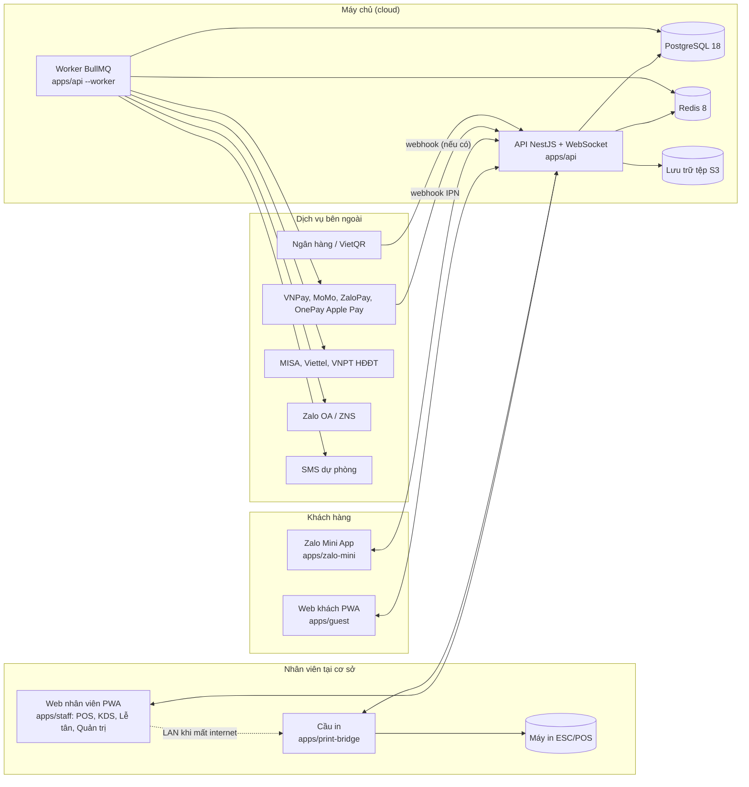

# Kiến trúc tổng thể DaLan OS

## 1. Bức tranh chung



## 2. Monorepo

```
dalan/
  apps/
    api/            NestJS 12 (Fastify), REST + Socket.IO, BullMQ workers, Swagger
    staff/          Next.js 16: POS phục vụ, thu ngân, KDS, lễ tân, quản trị, báo cáo (PWA, offline queue)
    guest/          Next.js 16: trang QR, thực đơn, gọi món, thanh toán, đặt bàn, thành viên (PWA, song ngữ)
    zalo-mini/      Zalo Mini App (zmp-ui), dùng chung API và api-client
    print-bridge/   Dịch vụ Node chạy tại cơ sở: nhận lệnh in, điều khiển máy in ESC/POS, hàng đợi offline
  packages/
    domain/         Logic nghiệp vụ thuần TypeScript, không phụ thuộc framework: tiền tệ, tính bill, chia bill,
                    VietQR, máy trạng thái phiên/đơn/dòng, định lượng, lịch khả dụng. Kiểm thử đơn vị đầy đủ.
    db/             Prisma schema, migrations, client, seed (đọc data/seed/*.json)
    contracts/      Kiểu dữ liệu và schema Zod dùng chung giữa API và các app (DTO, sự kiện realtime)
    api-client/     Client HTTP + Socket typed cho các app
    ui/             Thành phần giao diện dùng chung (Tailwind 4), token thiết kế, định dạng tiền/ngày tiếng Việt
    i18n/           Chuỗi dịch vi/en cho app khách; chuỗi tiếng Việt cho app nhân viên
    config/         tsconfig, eslint, prettier dùng chung
  data/seed/        Dữ liệu mẫu Dạ Lan (thực đơn thật, cơ sở, trạm, bàn mẫu)
  infra/            docker-compose (dev và prod), Dockerfile, nginx, script sao lưu
  docs/             Nghiên cứu, đặc tả, kiến trúc, ADR, vận hành
```

Công cụ: pnpm workspaces + Turborepo, TypeScript 5.9 strict, Vitest, Playwright, ESLint 10 flat
config, Prettier. Node 24 LTS.

## 3. Lớp API

- **NestJS 12 trên Fastify**: mô-đun theo bounded context: `auth`, `org` (cơ sở, khu vực, bàn, nhân sự, vai trò, thiết bị, ca), `menu`, `dining` (phiên bàn, đơn, dòng, yêu cầu khách), `kitchen`, `billing` (bill, thanh toán, hoàn tiền, két), `invoicing` (HĐĐT), `reservations`, `customers` (hồ sơ, điểm, voucher), `events` (tiệc), `inventory`, `reports`, `notifications`, `printing`, `integrations` (bộ chuyển đổi), `realtime`, `outbox`.
- **Lệnh và truy vấn**: handler mỏng, logic tính toán gọi `packages/domain`. Mọi lệnh ghi có `Idempotency-Key` (khóa chống trùng) lưu 24 giờ để client gửi lại an toàn.
- **Outbox**: mỗi giao dịch ghi kèm bản ghi `DomainEvent` (loại, cơ sở, khóa tổng hợp, payload, số thứ tự). Worker đọc outbox để: phát realtime qua Redis pub/sub, tạo lệnh in, gửi ZNS, phát hành HĐĐT, trừ kho, cộng điểm, cập nhật bảng báo cáo. Nhờ đó mọi tác dụng phụ đều có thể thử lại và truy vết.
- **Realtime**: Socket.IO namespace `/staff` (phòng theo cơ sở, trạm, bàn) và `/guest` (phòng theo phiên). Redis adapter để chạy nhiều bản API. Client nhận `seq` để tải bù sự kiện bị lỡ.
- **Bảo mật**: JWT (access 15 phút, refresh 30 ngày xoay vòng) cho nhân viên và khách thành viên; token phiên khách (guest token) ký riêng, chỉ có quyền trên phiên đó; PIN đăng nhập nhanh trên thiết bị đã đăng ký; Guard kiểm tra quyền theo cơ sở; giới hạn tần suất; xác thực chữ ký webhook; Helmet, CORS.
- **Tài liệu**: Swagger/OpenAPI sinh tự động, dùng để sinh `packages/api-client`.

## 4. Dữ liệu

- PostgreSQL 18, Prisma 7 với driver adapter `pg`. Tiền tệ là `BigInt` (VND). Thời gian `timestamptz`. ID là UUID v7 (sắp xếp theo thời gian).
- Bảng vận hành đều có `branchId`; bảng cấu hình thực đơn ở cấp tổ chức với bảng ghi đè theo cơ sở.
- Mọi dòng tiền trên đơn là *snapshot* (tên, giá, thuế suất) để báo cáo lịch sử không đổi khi sửa thực đơn.
- Soft delete cho dữ liệu cấu hình; dữ liệu giao dịch không xóa, chỉ hủy có lý do.
- Báo cáo: bảng tổng hợp theo ngày và giờ cập nhật bởi worker từ outbox; truy vấn chi tiết đọc trực tiếp với chỉ mục theo `branchId, businessDate`.

## 5. Ứng dụng web

- **Next.js 16 App Router**, React 19, Tailwind 4, TanStack Query cho dữ liệu máy chủ, Zustand cho trạng thái giao diện, Dexie (IndexedDB) cho hàng đợi lệnh offline và đệm thực đơn, Serwist cho service worker.
- **Hàng đợi offline** (app nhân viên): mỗi thao tác ghi tạo lệnh với `Idempotency-Key`, lưu IndexedDB, phát lại theo thứ tự khi có mạng; giao diện hiển thị trạng thái "đang chờ gửi". Khi internet mất nhưng LAN còn, app gửi lệnh in trực tiếp tới cầu in để bếp vẫn nhận phiếu; khi mạng về, máy chủ nhận lệnh gốc và bỏ qua lệnh in trùng (cầu in báo lại khóa đã in).
- **App khách** tối ưu tải nhanh: trang QR render server, ảnh tối ưu, phân mảnh theo route, không thư viện nặng.
- **Màn hình bếp**: trang toàn màn hình, phím tắt, âm báo, tự kết nối lại.

## 6. Tích hợp qua bộ chuyển đổi

| Cổng | Giao diện | Triển khai giai đoạn 1 |
|---|---|---|
| `PaymentProvider` | `createIntent`, `verifyWebhook`, `query`, `refund` | `VietQrStatic` (sinh QR tại chỗ, xác nhận tay hoặc webhook ngân hàng), `VnPay`, `MoMo`, `ZaloPay`, `OnePay` (Apple Pay online), `CardTerminalManual` |
| `EInvoiceProvider` | `issue`, `cancel`, `replace`, `adjust`, `getPdf`, `lookupTaxCode` | `MisaMeInvoice`, `ViettelSInvoice`, `VnptInvoice`, `MockProvider` (kiểm thử) |
| `MessagingProvider` | `sendTemplate` (ZNS), `sendSms`, `sendEmail` | `ZaloZns`, `SmsFallback`, `Smtp`, `MockProvider` |
| `PrinterDriver` | `render(template, data) → ESC/POS`, `send` | `EscPosNetwork`, `EscPosUsb` trong cầu in |
| `StorageProvider` | `put`, `getSignedUrl` | S3 tương thích (MinIO khi tự host) |

Mỗi bộ chuyển đổi có bản `Mock` để chạy và kiểm thử toàn bộ hệ thống mà không cần hợp đồng
merchant; cấu hình chọn bộ chuyển đổi theo cơ sở qua biến môi trường và bảng cấu hình.

## 7. Triển khai

- **Dev**: `docker compose up` (PostgreSQL, Redis, MinIO) + `pnpm dev` chạy API và các app; seed dữ liệu Dạ Lan.
- **Prod giai đoạn 1**: một máy chủ ảo (4 vCPU, 8 GB) tại Việt Nam (Viettel IDC, VNG Cloud hoặc AWS ap-southeast-1) chạy docker compose: nginx (TLS), api ×2, worker, staff, guest, postgres, redis, minio; sao lưu hằng ngày lên lưu trữ đối tượng. Tên miền gợi ý: `app.dalan.com.vn` (nhân viên), `menu.dalan.com.vn` (khách), `api.dalan.com.vn`.
- **Cầu in**: chạy trên một PC Windows tại mỗi cơ sở dưới dạng dịch vụ (pm2 hoặc NSSM), tự khởi động, có trang trạng thái nội bộ.
- **Quan sát**: log JSON (pino) gom về Loki hoặc CloudWatch, chỉ số Prometheus, health check `/health`.

## 8. Lộ trình bàn giao

| Đợt | Nội dung | Kết quả kiểm chứng |
|---|---|---|
| 1 | Monorepo, schema, seed, domain core, API lõi (auth, org, menu, dining, kitchen, billing tiền mặt + VietQR), app nhân viên (sơ đồ bàn, gọi món, KDS, thu ngân), app khách (QR, gọi món, bill, VietQR), cầu in | Chạy end-to-end tại một cơ sở với dữ liệu Dạ Lan |
| 2 | Cổng thanh toán VNPay/MoMo/ZaloPay/OnePay, HĐĐT, đặt bàn, khách hàng và tích điểm, Zalo ZNS, Zalo Mini App | Thanh toán sandbox thành công, HĐĐT trên môi trường test nhà cung cấp |
| 3 | Tiệc và sự kiện, kho và định lượng, báo cáo nâng cao, kết nối kế toán | Quy trình tiệc mẫu 80 mâm chạy trọn vẹn |
